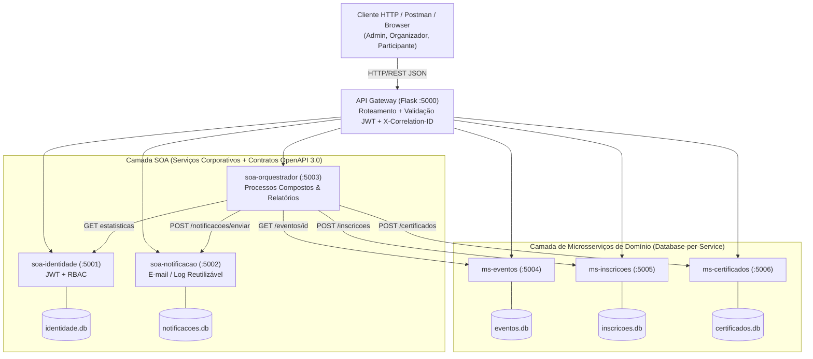
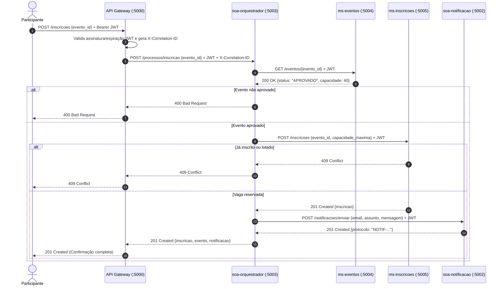
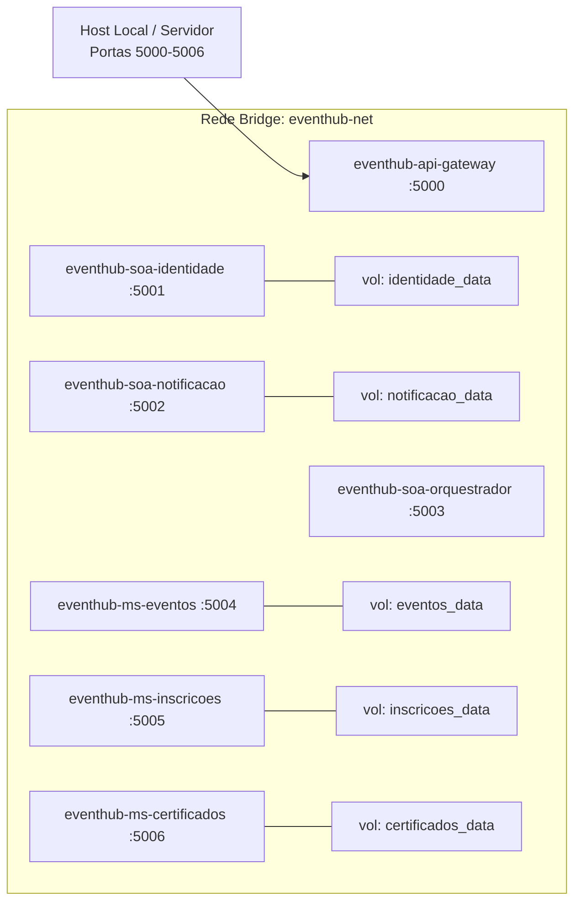

# Manual Técnico e Arquitetural — EventHub

**Repositório:** `gerenciador-de-eventos` (`https://github.com/ronaldocrispimsg/gerenciador-de-eventos/tree/main`)  
**Stack:** Python 3.13 · Flask 3.1 · REST/JSON · SQLite (*Database-per-Service*) · JWT (HS256) · OpenAPI 3.0.3 · Docker Compose

---

## 1. Contexto do Problema, Escopo e Perfis de Usuário

### 1.1 Problema e Escopo
Uma universidade necessita de um sistema centralizado para gerenciar seus eventos acadêmicos, abrangendo **semanas acadêmicas**, **palestras** e **minicursos**. A equipe de TI estabeleceu uma diretriz arquitetural híbrida:
1. Serviços transversais corporativos que também possam ser reutilizados por outros sistemas da instituição (como autenticação e envio de notificações) devem seguir o estilo **SOA** com contratos formais OpenAPI.
2. Serviços específicos do domínio de eventos acadêmicos devem ser construídos como **microsserviços pequenos e independentes**, cada qual com seu próprio banco de dados isolado, proibindo qualquer compartilhamento direto de base entre eles.

### 1.2 Perfis de Usuário (RBAC)
O sistema suporta no mínimo três perfis bem definidos com controle de acesso via JWT:

| Perfil (`role`) | Responsabilidades Principais |
| :--- | :--- |
| **`admin`** | Gerencia usuários e perfis (`GET/POST /usuarios`, `PATCH /usuarios/<id>/perfil`), aprova ou rejeita eventos (`PATCH /eventos/<id>/aprovar`), e consulta relatórios gerenciais consolidados (`GET /relatorios/geral`). |
| **`organizador`** | Cria novos eventos (`POST /eventos`), edita exclusivamente seus próprios eventos (`PUT /eventos/<id>`), visualiza a lista de inscritos (`GET /eventos/<id>/inscritos`) e registra presença (`PATCH /inscricoes/<id>/presenca`). |
| **`participante`** | Consulta eventos aprovados (`GET /eventos`), realiza inscrição via fluxo orquestrado (`POST /inscricoes`), cancela sua inscrição (`PATCH /inscricoes/<id>/cancelar`), emite certificados após presença confirmada (`POST /certificados/emitir`) e valida códigos de autenticidade. |

---

## 2. Decisão Arquitetural: SOA versus Microsserviços na Arquitetura Híbrida

### 2.1 Por que cada serviço é SOA ou Microsserviço?

| Serviço | Camada | Porta | Justificativa Arquitetural |
| :--- | :---: | :---: | :--- |
| **`api-gateway`** | Entrada (Borda) | `5000` | Ponto único de entrada (*Single Entry Point*), responsável por validação preliminar de assinatura JWT, geração/propagação de `X-Correlation-ID` e roteamento HTTP para as camadas internas. |
| **`soa-identidade`** | **SOA** | `5001` | Serviço corporativo reutilizável por qualquer sistema universitário (Biblioteca, Portal do Aluno, EventHub) para emissão/validação de JWT e gestão centralizada de identidades com contrato formal OpenAPI 3.0.3. |
| **`soa-notificacao`** | **SOA** | `5002` | Serviço corporativo genérico de mensageria/auditoria de avisos (e-mail, SMS, sistema) parametrizado por `sistema_origem`, permitindo reuso institucional desacoplado. |
| **`soa-orquestrador`** | **SOA** | `5003` | Implementa o padrão clássico SOA de **orquestração de processos de negócio compostos** (inscrição, cancelamento, emissão de certificado e agregação de relatórios), evitando que clientes tenham de coordenar múltiplos serviços manualmente. |
| **`ms-eventos`** | **Microsserviço** | `5004` | Domínio delimitado (*Bounded Context*) responsável apenas pelo ciclo de vida dos eventos acadêmicos (criação, edição, aprovação) com banco próprio (`eventos.db`). |
| **`ms-inscricoes`** | **Microsserviço** | `5005` | Domínio delimitado focado em vagas, controle de duplicidade, cancelamentos e registro de presença em `inscricoes.db`. |
| **`ms-certificados`** | **Microsserviço** | `5006` | Domínio delimitado para geração de códigos verificadores únicos e validação pública de autenticidade em `certificados.db`. |

### 2.2 Vantagens e Desvantagens da Abordagem Híbrida

* **Vantagens:**
  * **Reutilização corporativa real:** `soa-identidade` e `soa-notificacao` servem toda a universidade com contratos OpenAPI versionados sem replicar lógica de autenticação ou disparo de notificações em cada microsserviço.
  * **Desacoplamento de dados no domínio:** A regra *Database-per-Service* nos microsserviços (`ms-eventos`, `ms-inscricoes`, `ms-certificados`) permite evolução e escalabilidade independentes sem bloqueios de esquema compartilhado.
  * **Experiência simplificada no cliente:** O `soa-orquestrador` encapsula fluxos multi-etapas (`inscrever -> notificar -> confirmar`) em uma única chamada transacional percebida pelo cliente.
* **Desvantagens / Trade-offs:**
  * **Latência adicional em saltos HTTP:** Uma chamada orquestrada percorre `Cliente -> Gateway -> Orquestrador -> Microsserviços -> Notificacao`.
  * **Ausência de transações ACID distribuídas:** Caso `soa-notificacao` falhe após `ms-inscricoes` gravar, o sistema exige tratamento de consistência eventual (ou compensação manual/assíncrona).
  * **Maior complexidade operacional:** Requer gestão de 7 processos/containers, contratos distintos e correlação distribuída via `X-Correlation-ID`.

---

## 3. Diagramas de Arquitetura (C4 e UML)

### 3.1 Diagrama de Containers (Nível C2 — Visão Híbrida)


### 3.2 Diagrama de Sequência UML — Fluxo Orquestrado de Inscrição


### 3.3 Diagrama de Implantação (Docker Compose)


---

## 4. Catálogo de Endpoints, Contratos OpenAPI e Matriz RBAC

Todos os serviços expõem especificação OpenAPI 3.0.3 em `GET /openapi.json`, documentação Swagger UI em `GET /apidocs` e sonda de integridade em `GET /health`.

| Serviço | Método e Rota (via Gateway `:5000`) | Perfis Permitidos | Códigos HTTP |
| :--- | :--- | :--- | :--- |
| `soa-identidade` | `POST /auth/login` | Público | `200`, `400`, `401` |
| `soa-identidade` | `POST /auth/register` | Público (cria `participante`) | `201`, `400`, `409` |
| `soa-identidade` | `GET /auth/validate` | Qualquer autenticado | `200`, `401` |
| `soa-identidade` | `GET /usuarios` | `admin` | `200`, `401`, `403` |
| `soa-identidade` | `POST /usuarios` | `admin` | `201`, `400`, `401`, `403`, `409` |
| `soa-identidade` | `GET /usuarios/{id}` | `admin` ou próprio usuário | `200`, `401`, `403`, `404` |
| `soa-identidade` | `PATCH /usuarios/{id}/perfil` | `admin` | `200`, `400`, `401`, `403`, `404` |
| `soa-notificacao` | `POST /notificacoes/enviar` | `admin`, `organizador`, `participante` | `201`, `400`, `401` |
| `soa-notificacao` | `GET /notificacoes` | `admin` (todas) / demais (próprias) | `200`, `401` |
| `ms-eventos` | `GET /eventos` | `admin`, `organizador`, `participante` (só aprovados) | `200`, `401` |
| `ms-eventos` | `POST /eventos` | `organizador`, `admin` | `201`, `400`, `401`, `403` |
| `ms-eventos` | `PUT /eventos/{id}` | `organizador` (dono) ou `admin` | `200`, `400`, `401`, `403`, `404` |
| `ms-eventos` | `PATCH /eventos/{id}/aprovar` | `admin` | `200`, `400`, `401`, `403`, `404` |
| `soa-orquestrador` | `POST /inscricoes` (ou `/processos/inscricao`) | `participante`, `admin` | `201`, `400`, `401`, `403`, `404`, `409` |
| `ms-inscricoes` | `GET /inscricoes/minhas` | `participante`, `admin` | `200`, `401`, `403` |
| `ms-inscricoes` | `GET /eventos/{id}/inscritos` | `organizador`, `admin` | `200`, `401`, `403` |
| `soa-orquestrador` | `PATCH /inscricoes/{id}/cancelar` | `participante` (dono) ou `admin` | `200`, `400`, `401`, `403`, `404` |
| `ms-inscricoes` | `PATCH /inscricoes/{id}/presenca` | `organizador`, `admin` | `200`, `400`, `401`, `403`, `404` |
| `soa-orquestrador` | `POST /certificados/emitir` | `participante`, `admin` | `201`, `400`, `401`, `403`, `404`, `409` |
| `ms-certificados` | `GET /certificados/meus` | `participante`, `admin` | `200`, `401` |
| `ms-certificados` | `GET /certificados/validar/{codigo}` | Público | `200`, `404` |
| `soa-orquestrador` | `GET /relatorios/geral` | `admin` | `200`, `401`, `403` |

---

## 5. Modelo de Dados por Serviço (*Database-per-Service*)

Cada serviço gerencia exclusivamente seu próprio arquivo SQLite:

1. **`identidade.db` (`soa-identidade`) — Tabela `usuarios`:**
   `id` (PK), `nome`, `email` (UNIQUE), `senha_hash` (PBKDF2/scrypt via Werkzeug), `role` (`admin` | `organizador` | `participante`), `ativo`, `criado_em`.
2. **`notificacoes.db` (`soa-notificacao`) — Tabela `notificacoes`:**
   `id` (PK), `protocolo` (UNIQUE), `destinatario_email`, `destinatario_nome`, `assunto`, `mensagem`, `canal` (`EMAIL` | `SISTEMA` | `SMS`), `sistema_origem`, `referencia_externa`, `status`, `enviado_em`.
3. **`eventos.db` (`ms-eventos`) — Tabela `eventos`:**
   `id` (PK), `titulo`, `descricao`, `tipo` (`SEMANA_ACADEMICA` | `PALESTRA` | `MINICURSO`), `data_evento`, `local`, `capacidade`, `carga_horaria`, `organizador_id`, `organizador_nome`, `status` (`PENDENTE` | `APROVADO` | `REJEITADO`), `criado_em`.
4. **`inscricoes.db` (`ms-inscricoes`) — Tabela `inscricoes`:**
   `id` (PK), `evento_id`, `participante_id`, `participante_nome`, `participante_email`, `status` (`ATIVA` | `CANCELADA`), `presenca` (`0` | `1`), `criado_em`.
5. **`certificados.db` (`ms-certificados`) — Tabela `certificados`:**
   `id` (PK), `codigo_verificacao` (UNIQUE, ex.: `EVTHUB-2026-XXXXXXXX`), `inscricao_id` (UNIQUE), `evento_id`, `evento_titulo`, `tipo_evento`, `carga_horaria`, `participante_id`, `participante_nome`, `participante_email`, `emitido_em`.

---

## 6. Autenticação e Segurança JWT (Geração, Propagação e Validação)

1. **Geração (`soa-identidade`):** Ao validar e-mail e senha no `POST /auth/login`, o serviço invoca `common.auth.generate_token()`, gerando um JWT assinado com algoritmo `HS256` e chave `JWT_SECRET`, contendo as *claims* `sub` (string do ID), `user_id` (inteiro), `nome`, `email`, `role`, `iat` e `exp` (padrão 8 horas).
2. **Propagação (`api-gateway` e `soa-orquestrador`):** Toda requisição recebida com `Authorization: Bearer <token>` tem o cabeçalho preservado integralmente nas chamadas HTTP subsequentes via `common.http_client.service_request()`, acompanhada de `X-Correlation-ID` para rastreabilidade.
3. **Validação (*Defense-in-Depth*):** Além da checagem inicial no `api-gateway` (que bloqueia tokens ausentes, adulterados ou expirados com `401`), cada microsserviço e serviço SOA aplica o decorator `@require_roles(...)` em suas rotas. Assim, mesmo chamadas diretas internas ou acessos fora do Gateway aplicam validação criptográfica do JWT e bloqueio RBAC (`403 Forbidden`).

---

## 7. Guia de Instalação e Execução

### Opção A — Docker Compose (Um Comando)
```bash
cp .env.example .env
docker compose up --build
```
O Gateway estará acessível em `http://127.0.0.1:5000` e os contratos Swagger em `http://127.0.0.1:5001/apidocs` (Identidade), `5002/apidocs` (Notificação) e `5003/apidocs` (Orquestrador).

### Opção B — Execução Local com Python `.venv`
```bash
# Ativar ambiente virtual e rodar todos os 7 servicos em processos independentes
.venv/bin/python scripts/run_all.py
```

### Executar Suíte de Testes Automatizados (`pytest`)
```bash
.venv/bin/python -m pytest -v
```

---

## 8. Roteiro de Testes por Perfil (Exemplos `curl`)

Credenciais *seed* iniciais (ambiente de desenvolvimento):
- **Admin:** `admin@universidade.edu.br` / `Admin@123`
- **Organizador:** `organizador@universidade.edu.br` / `Org@123`
- **Participante:** `participante@universidade.edu.br` / `Part@123`

```bash
# 1. Login como Organizador
TOKEN_ORG=$(curl -s -X POST http://127.0.0.1:5000/auth/login \
  -H "Content-Type: application/json" \
  -d '{"email":"organizador@universidade.edu.br","senha":"Org@123"}' | python3 -c "import sys,json;print(json.load(sys.stdin)['access_token'])")

# 2. Organizador cria evento (201 Created, status PENDENTE)
curl -s -X POST http://127.0.0.1:5000/eventos \
  -H "Authorization: Bearer $TOKEN_ORG" \
  -H "Content-Type: application/json" \
  -d '{"titulo":"Semana de Computacao","descricao":"Palestras","tipo":"SEMANA_ACADEMICA","data_evento":"2026-12-05","local":"Auditorio","capacidade":50,"carga_horaria":16}'

# 3. Admin aprova evento #1 (200 OK)
TOKEN_ADM=$(curl -s -X POST http://127.0.0.1:5000/auth/login \
  -H "Content-Type: application/json" \
  -d '{"email":"admin@universidade.edu.br","senha":"Admin@123"}' | python3 -c "import sys,json;print(json.load(sys.stdin)['access_token'])")

curl -s -X PATCH http://127.0.0.1:5000/eventos/1/aprovar \
  -H "Authorization: Bearer $TOKEN_ADM" \
  -H "Content-Type: application/json" \
  -d '{"status":"APROVADO"}'

# 4. Participante inscreve-se via fluxo orquestrado (201 Created)
TOKEN_PART=$(curl -s -X POST http://127.0.0.1:5000/auth/login \
  -H "Content-Type: application/json" \
  -d '{"email":"participante@universidade.edu.br","senha":"Part@123"}' | python3 -c "import sys,json;print(json.load(sys.stdin)['access_token'])")

curl -s -X POST http://127.0.0.1:5000/inscricoes \
  -H "Authorization: Bearer $TOKEN_PART" \
  -H "Content-Type: application/json" \
  -d '{"evento_id":1}'
```

---

## 9. Evoluções Futuras da Arquitetura

1. **Mensageria Assíncrona (RabbitMQ):** Desacoplar a chamada síncrona entre `soa-orquestrador` e `soa-notificacao` publicando eventos como `InscricaoConfirmada` e `CertificadoEmitido` em *exchanges* do RabbitMQ. Dessa forma, picos de inscrições ou instabilidades no servidor SMTP não travam o retorno HTTP da inscrição.
2. **Service Discovery (Consul / DNS Kubernetes):** Substituir as URLs estáticas de variáveis de ambiente (`EVENTOS_URL`, `INSCRICOES_URL`) por registro dinâmico de instâncias saudáveis via Consul ou Kubernetes Services, permitindo balanceamento de carga com múltiplas réplicas de cada microsserviço.
3. **Circuit Breaker e Retentativas com Backoff (Resilience Patterns):** Proteger o `api-gateway` e o `soa-orquestrador` (ex.: com `pybreaker` ou Envoy) para que, caso `soa-notificacao` ou `ms-certificados` apresentem lentidão, o circuito abra rapidamente evitando esgotamento de *threads* (*fail-fast*) e habilitando respostas degradadas controladas.
